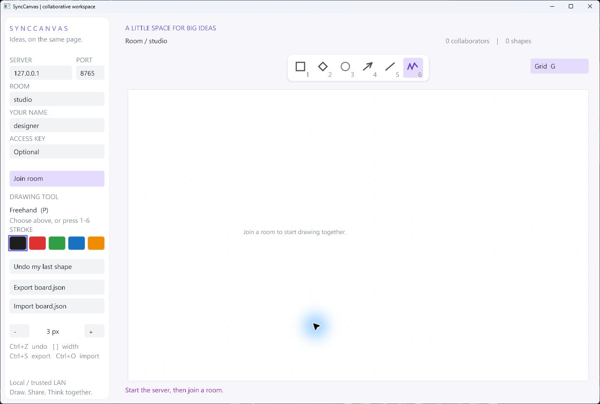

# SyncCanvas

### A shared canvas. A native C++ application. A real network between them.

SyncCanvas is a collaborative desktop whiteboard built with **C++20**, **VectorGL**, and **standalone Asio**. Run one server, join the same room from multiple clients, and draw together. The server validates and orders edits; each client renders the same accepted board state.

This is a working portfolio application for local and trusted LAN use. It uses production-oriented structure and bounded networking, but it is **not an authenticated, encrypted public service**. See [security and deployment](SECURITY.md).

A ready-to-import diagram is included in `examples/network-board.json`. Copy it to `board.json` in the client's working directory and use Import after joining an empty room.

## What it does

- Shared freehand strokes, rectangles, diamonds, ellipses, arrows, and lines with five stroke colors and adjustable widths.
- Named rooms, live participant cursors, and per-session undo of your own shapes.
- Optional server access key, masked entry, and a fixed join deadline.
- Shift-constrained geometry, a grid toggle, and select-all/paste for connection fields.
- Server-assigned IDs and monotonically increasing board revisions.
- Full board snapshots on join and reconnect, with automatic retry after connection loss.
- JSON import/export and periodic server-side persistence with atomic file replacement.
- Asynchronous reads/writes, frame limits, rate limits, connection deadlines, and bounded queues.
- Separate core, network, server, and desktop targets.

Drawing is shown locally while dragging and committed to everyone on release. Long pen strokes split at 512 points. Remote clients see live shape previews at up to 20 updates per second while you drag. Releasing the mouse commits the final shape; Escape or losing focus cancels its preview.

## Quick start

Requires CMake 3.24+, Git, a C++20 compiler, and internet access on the first configure. The desktop client needs an OpenGL 3.3 GPU and a supported system font. Dependency revisions are pinned in CMake. Dependency clang-tidy checks are opt-in with `-DSYNCCANVAS_LINT_DEPENDENCIES=ON`; the project formatting check remains separate.

With Ninja installed:

~~~sh
cmake --preset release
cmake --build --preset release
~~~

Start the server, then two clients in separate terminals:

~~~sh
./build/release/synccanvas_server
./build/release/synccanvas_client --name alice --room studio
./build/release/synccanvas_client --name bob --room studio
~~~

Click **Join room** in each client. On Windows, append `.exe`. A packaged Windows build is provided separately; start its server first and then its client. The client never starts a hidden server automatically.

Without Ninja, use a default generator:

~~~sh
cmake -S . -B build -DCMAKE_BUILD_TYPE=Release
cmake --build build --config Release --target synccanvas_client synccanvas_server
~~~

Visual Studio places executables under `build/Release`. Use a Visual Studio developer shell for Ninja + MSVC. MinGW-w64 also works; keep its runtime DLLs on PATH or beside the executables.

On Ubuntu, install `xorg-dev libgl1-mesa-dev fonts-dejavu-core`. Font lookup supports Segoe UI on Windows, DejaVu Sans on Linux, and Arial on macOS. Windows MinGW builds were verified locally; Linux/MSVC workflows are included but their hosted results require running CI. macOS has not been verified.

### Server-only build

~~~sh
cmake --preset server
cmake --build --preset server
~~~

This build needs no graphics libraries or display.

### Connecting over a trusted LAN

The server binds to loopback by default. To explicitly listen on other interfaces:

~~~sh
synccanvas_server --bind 0.0.0.0 --port 8765 --data boards
synccanvas_client --host SERVER_LAN_ADDRESS --port 8765 --room studio --name alice
~~~

Use the same room name in each client. Each room keeps its saved drawings across reconnects and server restarts. For a blank board, disconnect, enter a new room name, then join again. Connection fields are locked while connected or retrying; leaving a room clears its displayed canvas without deleting saved drawings. Your network/firewall must permit the selected port; the application does not modify firewall settings. Do not expose this listener directly to the public internet.

### Optional access key

Set `SYNCCANVAS_ACCESS_KEY` before starting the server to require a shared key.
The value must contain 16-128 letters, digits, underscores, or hyphens; use a random
value rather than a password. Clients can read it from the same environment variable
or paste it into the masked Access key field. Leave the field blank for open servers.
The key gates all rooms on that server; it does not encrypt the connection or provide
per-room permissions. See [security details](SECURITY.md).

## Controls

| Control | Action |
|---|---|
| Server / port / room / name / access key fields | Click to edit before connecting; Tab moves between fields |
| Join room / Disconnect | Connect or stop reconnection attempts |
| Floating icon toolbar | Choose rectangle, diamond, ellipse, arrow, line, or freehand |
| 1-6 or R / D / E / A / L / P | Switch drawing tools |
| Left mouse drag | Draw on the board |
| Shift + drag | Square/circle/regular diamond; line/arrow angles snap to 45 degrees |
| Grid button or G | Toggle the canvas dot grid |
| Ctrl+A / Ctrl+V in a field | Select all / paste a validated value |
| Color swatches | Choose ink |
| + / - buttons or [ / ] | Set stroke width from 1 to 16 |
| Undo button or Ctrl+Z | Remove your latest committed shape |
| Export or Ctrl+S | Write the visible board to `board.json` in the working directory |
| Import or Ctrl+O | Add shapes from `board.json` to the current room |
| Escape | Cancel a draft, leave text editing, or close the app |

Names and room IDs accept ASCII letters, digits, underscores, and hyphens. Import is additive, not a replacement operation, and is throttled to 40 shapes per second. An interrupted import can be partial. Export atomically replaces an existing `board.json` only after the new file has been fully written; a failed export preserves the previous file. Server autosaves are separate. Imports and room archives are limited to 16 MiB while reading.

## Project structure

~~~text
include/synccanvas/       Public class contracts
  Board.hpp              Authoritative board model, IDs, ownership, revisions
  Protocol.hpp           Wire types, framing, validation
  Connection.hpp         Bounded asynchronous framed TCP transport
  NetworkClient.hpp      Network thread and UI event mailbox
  Server.hpp             Room/session lifecycle and persistence
  ClientView.hpp         View state, layout geometry, VectorGL renderer
  Application.hpp        Desktop lifecycle and interaction controller
src/
  core/                  Board and protocol implementation
  net/                   Transport and client connection lifecycle
  server/                Headless service and command-line entry point
  client/                Desktop controller, renderer, and entry point
docs/                    Architecture and protocol documentation
.github/workflows/       Build, test, and formatting checks
~~~

The application uses composition: transport does not know about rooms, the board does not know about sockets, and the renderer does not mutate shared board state. See [product direction](docs/ROADMAP.md), [architecture](docs/ARCHITECTURE.md), and [protocol](docs/PROTOCOL.md) for ownership, threading, and failure behavior.

## Verification

See [local validation](docs/VALIDATION.md) for historical build and interface checks. Automated test sources and CTest configuration have been removed from this project.

## Current boundaries

- No accounts, TLS, per-room passwords, browser client, text objects, selection, or collaborative object editing. The icon toolbar is inspired by diagramming apps; it does not provide Excalidraw file compatibility.
- Undo ownership is tied to a live connection. Reconnecting gets a new identity; saved shapes load with archive ownership.
- Autosave runs every two seconds on the server event loop; disk stalls can delay network work. A crash can lose changes since the last successful save.
- Up to 128 connections, 32 loaded rooms, 32 participants per room, 1500 shapes and 40,000 points per board. Loaded rooms remain in memory until restart.
- A reconnect replaces local state with a server snapshot. Offline edits are not buffered or merged.
- Each server is a single authoritative process; clustering and durable operation logs are future work.

## License and dependencies

MIT for SyncCanvas. VectorGL, Asio, nlohmann/json, GLFW, and VectorGL's other dependencies retain their own licenses. See [third-party notices](THIRD_PARTY_NOTICES.md).
