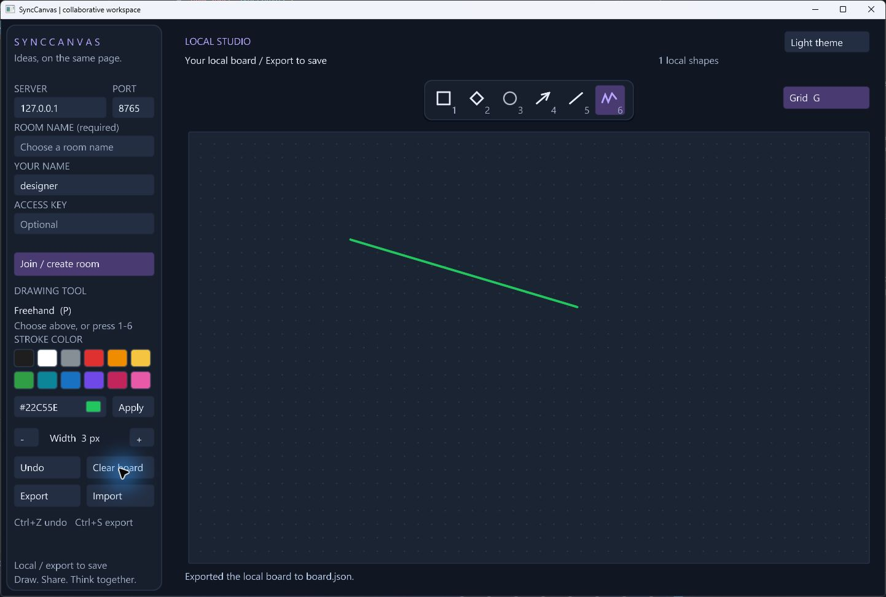

# SyncCanvas

### A shared canvas. A native C++ application. A real network between them.

SyncCanvas is a collaborative desktop whiteboard built with **C++20**, **VectorGL**, and **standalone Asio**. Start drawing locally right away, or run one server and join the same room from multiple clients to draw together. The server validates and orders edits; each client renders the same accepted board state.

This is a working portfolio application for local and trusted LAN use. It uses production-oriented structure and bounded networking, but it is **not an authenticated, encrypted public service**. See [security and deployment](SECURITY.md).

A ready-to-import diagram is included in `examples/network-board.json`. Copy it to `board.json` in the client's working directory and use Import after joining an empty room.

## What it does

- Offline local boards with undo, import/export, and explicit sharing into a room.
- Shared freehand strokes, rectangles, diamonds, ellipses, arrows, and lines with 12 preset stroke colors, custom RGB hex colors, and adjustable widths.
- Named rooms, live participant cursors, and per-session undo of your own shapes.
- Optional server access key, masked entry, and a fixed join deadline.
- Start/stop a server inside the desktop app, with LAN hosting enabled by default.
- Shift-constrained geometry, light/dark themes, a grid toggle, and select-all/paste for connection fields.
- Confirmed local clearing with Undo recovery, and owner-limited clearing in shared rooms.
- Server-assigned IDs and monotonically increasing board revisions.
- Full board snapshots on join and reconnect, with automatic retry after connection loss.
- JSON import/export and periodic server-side persistence with atomic file replacement.
- Asynchronous reads/writes, frame limits, rate limits, connection deadlines, and bounded queues.
- Separate core, network, server, and desktop targets.

Drawing is shown locally while dragging and committed to everyone on release. Long pen strokes split at 512 points. Remote clients see live shape previews at up to 20 updates per second while you drag. Releasing the mouse commits the final shape; Escape or losing focus cancels its preview.

Dark mode adds a contrast outline to very dark strokes so existing drawings stay
visible; original RGB values remain unchanged in exports and on the network. Theme
and color preferences currently last for the window session.

## Quick start

Requires CMake 3.24+, Git, a C++20 compiler, and internet access on the first configure. The desktop client needs an OpenGL 3.3 GPU and a supported system font. Dependency revisions are pinned in CMake. Dependency clang-tidy checks are opt-in with `-DSYNCCANVAS_LINT_DEPENDENCIES=ON`; the project formatting check remains separate.

With Ninja installed:

~~~sh
cmake --preset release
cmake --build --preset release
~~~

Start the server, then two clients in separate terminals:

~~~sh
./build/release/synccanvas_server
./build/release/synccanvas_client --name alice --room studio
./build/release/synccanvas_client --name bob --room studio
~~~

Click **Join / create room** in each client. Plain client launches start with an empty room field and stay local until you explicitly choose a room; the `--room studio` arguments above are an intentional example. On Windows, append `.exe`. A packaged Windows build is provided separately; start its server first and then its client. The client never starts a hidden server automatically.

Without Ninja, use a default generator:

~~~sh
cmake -S . -B build -DCMAKE_BUILD_TYPE=Release
cmake --build build --config Release --target synccanvas_client synccanvas_server
~~~

Visual Studio places executables under `build/Release`. Use a Visual Studio developer shell for Ninja + MSVC. MinGW-w64 also works; keep its runtime DLLs on PATH or beside the executables.

On Ubuntu, install `xorg-dev libgl1-mesa-dev fonts-dejavu-core`. Font lookup supports Segoe UI on Windows, DejaVu Sans on Linux, and Arial on macOS. Windows MinGW builds were verified locally; Linux/MSVC workflows are included but their hosted results require running CI. macOS has not been verified.

### Fedora desktop client

Install the native build tools, GLFW development package, OpenGL development files,
and DejaVu Sans, then build the client:

~~~sh
sudo dnf install git cmake ninja-build gcc-c++ glfw-devel mesa-libGL-devel dejavu-sans-fonts
git clone https://github.com/mahtab04/SyncCanvas.git
cd SyncCanvas
cmake --preset release
cmake --build --preset release --target synccanvas_client
./build/release/synccanvas_client
~~~

Fedora font lookup includes `/usr/share/fonts/dejavu-sans-fonts/DejaVuSans.ttf`.
The package paths are documented by [Fedora](https://packages.fedoraproject.org/pkgs/dejavu-fonts/dejavu-sans-fonts/fedora-43.html).
For a Windows-hosted room, click **Start server** in the Windows
client (or run the standalone server with `--bind 0.0.0.0`), then enter
its LAN IPv4 address, the same port, and the same chosen room name in both clients.
Use the configured access key if required. Windows executables do not run as native
Fedora applications; build the Linux client above. Fedora runtime behavior has not
been verified locally.

### Server-only build

~~~sh
cmake --preset server
cmake --build --preset server
~~~

This build needs no graphics libraries or display.

### Connecting over a trusted LAN

You can host directly from the desktop client:

1. Set the port and optional Access key before starting. Desktop hosting accepts
   connections from other computers on your network by default.
2. Click **Start server**. The client points itself at `127.0.0.1`; hosting does
   not join a room or upload your local drawing.
3. Enter a room name and click **Join / create room**. Other computers use the
   host PC's LAN IP, the same port, room name, and access key.
4. **Stop server** asks for confirmation within five seconds. It saves dirty rooms
   and disconnects everyone on this host. Closing the host window also stops it;
   Disconnect alone leaves the server running. Other windows' or standalone servers
   are never stopped by these controls.

Hosted rooms are stored separately from standalone server archives, under
`%LOCALAPPDATA%/SyncCanvas/hosted-boards/<port>` on Windows and
`$XDG_STATE_HOME/synccanvas/hosted-boards/<port>` on Linux (defaulting to
`~/.local/state/synccanvas/hosted-boards/<port>`). Restart with the same port to
reuse them. Port, server destination, and access key stay fixed while
hosting; stop first to change them. A port already in use reports a startup error.
Hosting accepts connections on all IPv4 interfaces. The client does not configure the firewall.

The standalone server binds to loopback by default. To listen on other interfaces:

~~~sh
synccanvas_server --bind 0.0.0.0 --port 8765 --data boards
synccanvas_client --host SERVER_LAN_ADDRESS --port 8765 --room studio --name alice
~~~

Use the same room name in each client. Each room keeps its saved drawings across reconnects and server restarts. For a blank board, disconnect, enter a new room name, then join again. Connection fields are locked while connected or retrying; leaving a room restores your separate local board without deleting room drawings. Your network/firewall must permit the selected port; the application does not modify firewall settings. Do not expose this listener directly to the public internet.

### Draw without connecting

Launch the client and draw immediately in **Local Studio**. Undo, Import, and Export
work without a server. The local board remains in memory when you join a room;
the room snapshot is displayed separately. **Add local** explicitly adds a copy of
your local shapes to the connected room, preserving the original. Disconnect returns
to your local board. During reconnection, use Disconnect to resume local drawing.

Use Export before closing to save local work to `board.json` in the client's working
directory. Launch from a writable directory. Local work is not automatically saved,
merged, or uploaded on connect. Clear board asks for a second click within five
seconds; Escape, timeout, or another action cancels it. Undo can restore the last
cleared local board. In a room, Clear mine removes only your current session's
shapes and waits for each server acknowledgement; other participants and archived
shapes are preserved. Disconnect cancels any remaining clear requests.

### Optional access key

Set `SYNCCANVAS_ACCESS_KEY` before starting the server to require a shared key.
The value must contain 16-128 letters, digits, underscores, or hyphens; use a random
value rather than a password. Clients can read it from the same environment variable
or paste it into the masked Access key field. Leave the field blank for open servers.
The key gates all rooms on that server; it does not encrypt the connection or provide
per-room permissions. See [security details](SECURITY.md).

## Controls

| Control | Action |
|---|---|
| Server / port / room / name / access key fields | Click to edit before connecting; Tab moves between fields |
| Join / create room / Disconnect | Join the entered room name (or create it if new), or disconnect |
| Floating icon toolbar | Choose rectangle, diamond, ellipse, arrow, line, or freehand |
| 1-6 or R / D / E / A / L / P | Switch drawing tools |
| Left mouse drag | Draw on the board |
| Shift + drag | Square/circle/regular diamond; line/arrow angles snap to 45 degrees |
| Grid button or G | Toggle the canvas dot grid |
| Ctrl+A / Ctrl+V in a field | Select all / paste a validated value |
| Color swatches / hex field + Apply | Choose a preset or any six-digit RGB color (for example `#22C55E`) |
| Dark theme / Light theme | Switch the interface and canvas theme for this window |
| Clear board / Confirm clear | Clear the local board; Undo restores the previous board |
| Clear mine / Confirm clear | Remove only shapes owned by your current room session |
| + / - buttons or [ / ] | Set stroke width from 1 to 16 |
| Undo button or Ctrl+Z | Remove your latest committed shape |
| Export or Ctrl+S | Write the visible board to `board.json` in the working directory |
| Import or Ctrl+O | Add shapes from `board.json` to the visible local board or room |
| Add local (while connected) | Add a copy of the local drawing to the current room |
| Escape | Cancel a draft, leave text editing, or close the app |

Names and room IDs accept ASCII letters, digits, underscores, and hyphens. Import is additive, not a replacement operation. Local imports validate the combined board before changing it. Room imports and Add local are throttled to 40 shapes per second and can be partial if interrupted. Repeating Add local adds another copy. Export atomically replaces an existing `board.json` only after the new file has been fully written; a failed export preserves the previous file. Server autosaves are separate. Imports and room archives are limited to 16 MiB while reading.

## Project structure

~~~text
include/synccanvas/       Public class contracts
  Board.hpp              Authoritative board model, IDs, ownership, revisions
  Protocol.hpp           Wire types, framing, validation
  Connection.hpp         Bounded asynchronous framed TCP transport
  NetworkClient.hpp      Network thread and UI event mailbox
  Server.hpp             Room/session lifecycle and persistence
  ClientView.hpp         View state, layout geometry, VectorGL renderer
  Application.hpp        Desktop lifecycle and interaction controller
src/
  core/                  Board and protocol implementation
  net/                   Transport and client connection lifecycle
  server/                Headless service and command-line entry point
  client/                Desktop controller, renderer, and entry point
docs/                    Architecture and protocol documentation
.github/workflows/       Build, test, and formatting checks
~~~

The application uses composition: transport does not know about rooms, the board does not know about sockets, and the renderer does not mutate shared board state. See [product direction](docs/ROADMAP.md), [architecture](docs/ARCHITECTURE.md), and [protocol](docs/PROTOCOL.md) for ownership, threading, and failure behavior.

## Verification

See [local validation](docs/VALIDATION.md) for historical build and interface checks. Automated test sources and CTest configuration have been removed from this project.

## Current boundaries

- No accounts, TLS, per-room passwords, browser client, text objects, selection, or collaborative object editing. The icon toolbar is inspired by diagramming apps; it does not provide Excalidraw file compatibility.
- Undo ownership is tied to a live connection. Reconnecting gets a new identity; saved shapes load with archive ownership.
- Autosave runs every two seconds on the server event loop; disk stalls can delay network work. A crash can lose changes since the last successful save.
- Up to 128 connections, 32 loaded rooms, 32 participants per room, 1500 shapes and 40,000 points per board. Loaded rooms remain in memory until restart.
- A reconnect replaces the visible room board with a server snapshot. The separate local board is kept in memory and never uploaded automatically. Local work must be exported before closing the app; local autosave is not implemented.
- Each server is a single authoritative process; clustering and durable operation logs are future work.

## License and dependencies

MIT for SyncCanvas. VectorGL, Asio, nlohmann/json, GLFW, and VectorGL's other dependencies retain their own licenses. See [third-party notices](THIRD_PARTY_NOTICES.md).
